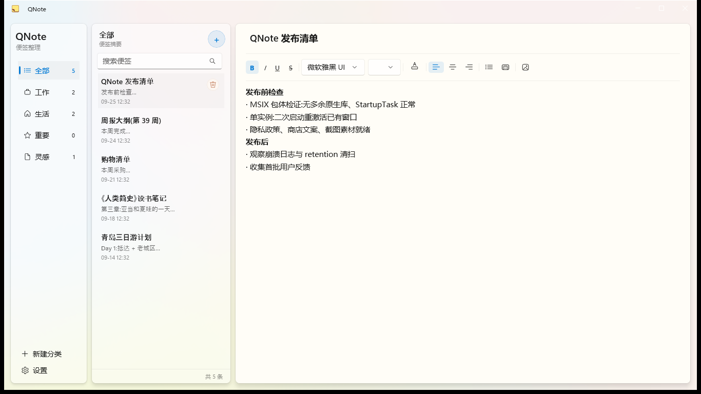
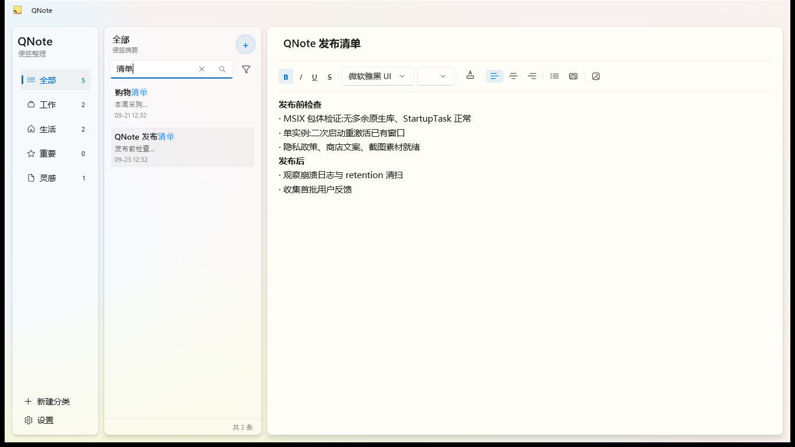
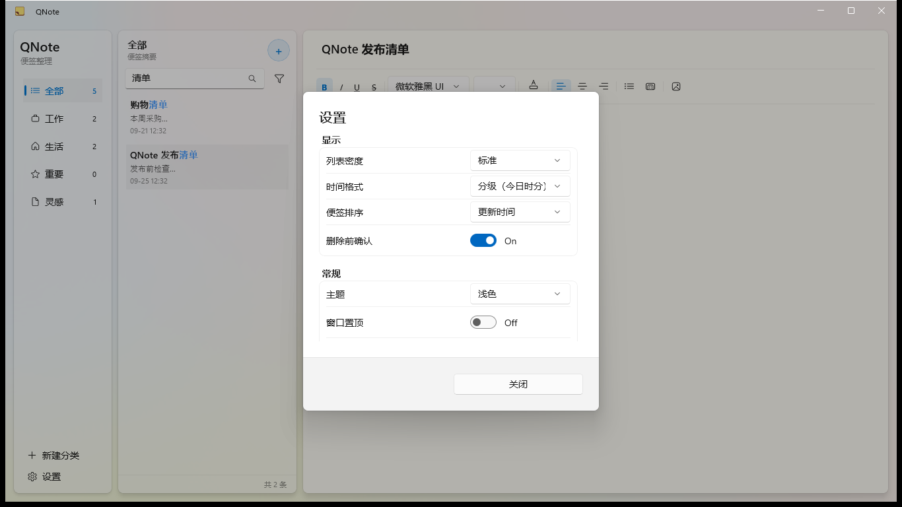
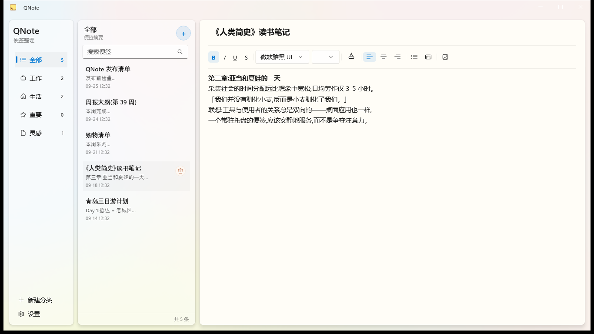
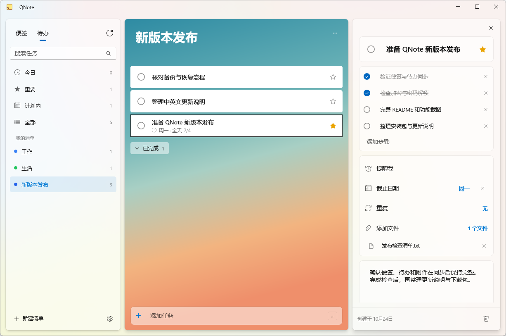
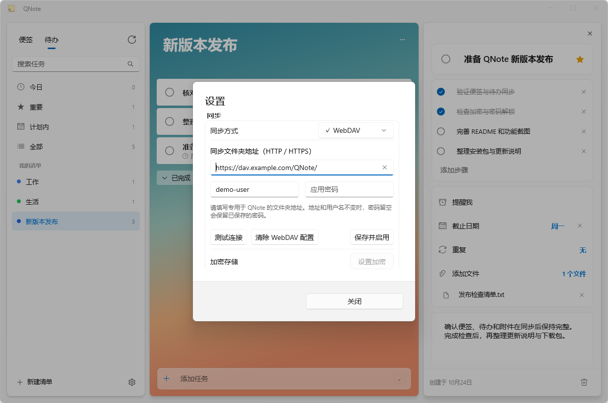
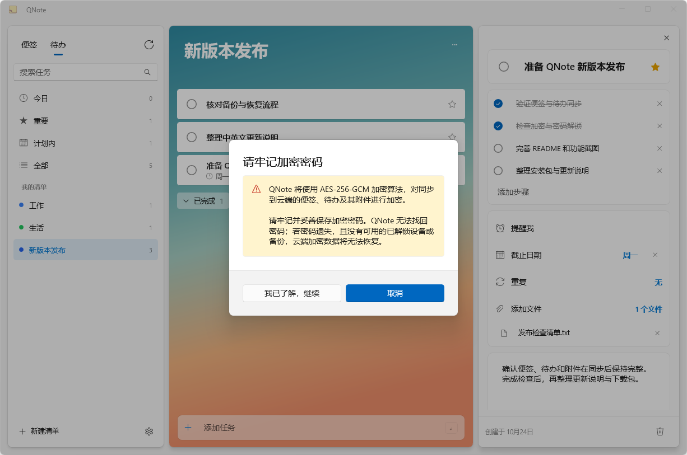
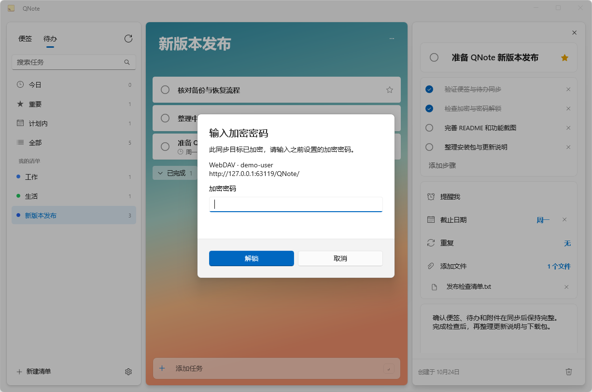

# QNote

[简体中文](README.md) | **English**

[](https://github.com/Mr-Second/QNote/actions/workflows/ci.yml)
[](https://github.com/Mr-Second/QNote/actions/workflows/release.yml)

A lightweight notes and tasks app for Windows, built with **WinUI 3**, with
**OneDrive / WebDAV sync** and **optional end-to-end encryption**.

QNote is a from-scratch C# / WinUI 3 rewrite of an earlier Qt/QML
implementation, with one north star: **low memory footprint**. Where the Qt
build idled at ~250 MB of RAM, QNote runs at roughly **60 MB** with the window
open and about **3 MB** when docked to the screen edge or minimized to the
tray — lean enough to keep running all day without thinking about it.

## Screenshots

| | |
|---|---|
|  |  |
|  |  |
|  |  |
|  |  |

The new screenshots use demonstration data.

## Features

- **Notes CRUD** with a rich-text editor and a formatting toolbar
  (bold / italic / lists / colors / …)
- **Instant search** powered by SQLite FTS5, with keyword highlighting
- **Categories** in the sidebar, drag-to-reorder
- **Image insertion** in notes (right-click to save as / alt text / replace)
- **Task lists** — Today / Important / Planned views, custom lists, steps,
  attachments, due-date reminders and recurring tasks
- **Multi-device sync** — use OneDrive or your own WebDAV server to sync notes,
  categories, task lists, steps and attachments automatically or on demand
- **Optional end-to-end encryption** — AES-256-GCM protection for cloud sync
  content, unlocked with your encryption password on each new device
- **Backup & restore** — `.qns` archives (ZIP + AES-256 encrypted) with three
  restore modes
- **Top-edge auto-hide** — dock notes to the screen edge; plus a global hotkey
- **System tray** with close-to-tray and launch-at-startup
- **Settings panel** — theme, sort order, density, always-on-top,
  remember window position
- **Crash dumps + rolling logs** for diagnostics

## Sync and encryption

QNote is local-first and works without a QNote account. To sync between Windows
devices, open **Settings → Sync**:

1. Choose **OneDrive** and sign in with Microsoft, or enter your **WebDAV** folder,
   username and app password.
2. Select **Apply**. If the destination already has content, choose how to merge
   it with this device or which copy should replace the other.
3. Configure the same destination on your other devices. Notes and Tasks both
   have a **Sync now** button.
4. For cloud content protection, select **Encrypted storage → Encrypt**, acknowledge
   the warning and set a separate encryption password.

Your encryption password is separate from your WebDAV app password. **Remember it
and keep it safe.** QNote cannot recover it. If you lose the password and have no
unlocked device or usable backup, your encrypted cloud data cannot be recovered.
Turning encryption off requires confirmation and converts the cloud data before
reporting successful decryption.

Encryption protects **cloud sync content**, not the local database. Cloud file
names, entry identifiers and some synchronization metadata remain visible.
Use HTTPS for WebDAV where possible: HTTP does not protect account credentials,
even with content encryption enabled. Deletions also sync, so keep independent
backups. Sign-in state, WebDAV credentials and remembered encryption keys are
protected for the current Windows user; moving to another computer or Windows
account requires signing in or configuring the destination again and entering
the encryption password.

See the [privacy policy](docs/privacy-policy.md) for data handling details.

## Install

Two channels, same app:

- **Microsoft Store** (recommended — one-click install, auto-updates,
  Microsoft-trusted signing): [QNote on Microsoft Store](https://apps.microsoft.com/detail/9NV57VJPTPCZ)
- **Portable zip** (green software — runs from any folder, data travels with
  it) from [Releases](https://github.com/Mr-Second/QNote/releases):
  `QNote_<version>_win-x64_native-aot.zip` — NativeAOT-compiled: small
  download, fast startup, zero dependencies

Unzip anywhere writable and run `QNote.exe`. All data (notes DB, images,
logs) lives in a `data\` folder next to the exe — copy the folder to migrate.
Portable zips are not code-signed; verify downloads against the
`SHA256SUMS.txt` published with each release (see
[docs/code-signing-policy.md](docs/code-signing-policy.md)).

Separate PDB archives are available for release debugging. Use the exact version
and distribution channel; see the [symbol guide](docs/debugging-symbols.md).

Store and portable installs are independent — both can coexist on one machine.

**Requirements:** Windows 10 19041+ / Windows 11, x64.

## Build from source

Requires **.NET 10 SDK** on Windows.

```powershell
# Build
dotnet build QNote.slnx -c Debug

# Run the app
dotnet run --project src/QNote/QNote.csproj -c Debug

# Run tests (Core layer, headless)
dotnet test tests/QNote.Tests/QNote.Tests.csproj -c Debug
```

## Tech stack

| Concern | Choice |
|---|---|
| UI | WinUI 3 / Windows App SDK 2.5.1, XAML with `x:Bind` |
| Runtime | .NET 10 |
| MVVM | CommunityToolkit.Mvvm |
| Data | SQLite via Microsoft.Data.Sqlite, FTS5 full-text search |
| Tests | xUnit |
| Distribution | Microsoft Store (MSIX) + portable zips (GitHub Releases) |

## License

[MIT](LICENSE)

## Community

This open-source project links to and acknowledges the
[LINUX DO](https://linux.do) community.
